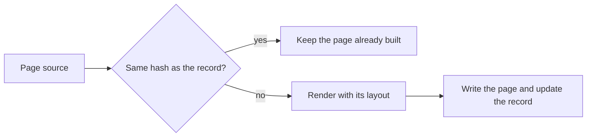

# A complete description

An invented change, to show the whole shape: a static site builder that now rebuilds only the pages whose source changed. Describe the change in front of you in its own terms; this one's choice of views fits this change, not every change. It is a behaviour change, a new path through the build, so it draws a flowchart and the diff sketch behind it, where a change of a few lines would need only the diff sketch.

---

## Why the change

Writers can preview an edit to one page without rebuilding the whole site, because the builder now renders only the pages whose source changed since the last build.

**Risk: 🟡 Medium** · **Door: two-way** · **Blast radius: anyone who builds after a layout edit**

- Why medium: the new hash check in the build loop skips unchanged pages, so a build after a layout edit now produces different pages for every existing site (read from the code, not run), but nothing the change writes outlives a revert.
- Walk it back: a revert is enough, because the old builder renders every page again and ignores `.build-record.json`, the only new file, which stays out of the repository.

## Special things to note

- An edit to a shared layout no longer reaches pages whose own source is unchanged, so after a layout change those pages keep the old layout until a full rebuild with `--clean` (read from the code, not run).
- `.gitignore` keeps the new `.build-record.json` out of the repository, so a build in a fresh checkout, such as a CI job, is no faster: with no record, it still renders every page (read from the code, not run).

## Change outline

The path each page now takes through a build: only a page whose source does not match the record from the last build is rendered.



The build loop, old and new: it gains the check and the record. Rendering and writing are unchanged.

```diff
 build(site)
+  record = load(".build-record.json")
   for each page in site
+    if hash(page.source) == record[page]
+      continue
     render page with its layout
     write page
+    record[page] = hash(page.source)
+  save(record)
```
