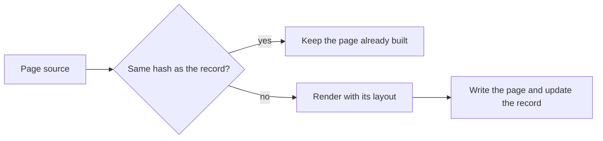

# A complete description

An invented change, to show the whole shape: a static site builder that now rebuilds only the pages whose source changed. Describe the change in front of you in its own terms; this one's choice of views fits this change, not every change.

---

## Why the change

Writers can preview an edit to one page without rebuilding the whole site, because the builder now renders only the pages whose source changed since the last build.

## Special things to note

- An edit to a shared layout no longer reaches pages whose own source is unchanged, so after a layout change those pages keep the old layout until a full rebuild with `--clean`.
- The builder now writes `.build-record.json` at the site root, and `.gitignore` lists it.

## Change outline

Each page is now checked against the record from the last build, and only a page whose source changed is rendered again.



The build loop gains the check and the record. Rendering and writing are unchanged.

```diff
 build(site)
+  record = load(".build-record.json")
   for each page in site
+    if hash(page.source) == record[page]
+      continue
     render page with its layout
     write page
+    record[page] = hash(page.source)
+  save(record)
```
