# Rendering on GitHub

The rules that keep a description rendering as you wrote it in a pull request description or comment. GitHub draws each `mermaid` block in the reader's browser, and only when the whole block parses: one bad label and the reader sees an error box where the diagram should be. Some mistakes parse but quietly cut a label short, so the reader sees less than you wrote and nothing tells them. A table or fence that GitHub reads differently shows raw pipes, or turns the rest of the description into code.

Every rule here comes from GitHub's docs and messages, the GitHub Flavored Markdown spec, or Mermaid's docs and grammar. GitHub does not publish its Mermaid version; the Mermaid rules and examples are checked against Mermaid 12.2.0, the version GitHub's viewer bundle loaded on 2026-11-10. GitHub can change that version without notice, so keep to the syntax shown here, which older versions parse too.

The examples are invented: an image service that resizes uploads into thumbnails.

## Every Mermaid diagram

### Keep evidence labels out of diagram labels

A label that says how you know a claim, such as whether you ran something or read it in the code, goes on a prose line: a lead-in, a note or a table cell. In a diagram it breaks things: its parentheses end an unquoted flowchart label, and backticks inside a quoted one can start Mermaid's Markdown-string syntax.

Right: the lead-in "Where an upload goes now (read from the code, not run):" above a diagram that draws only the flow.

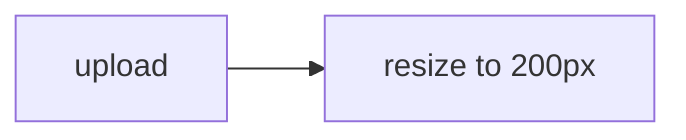

Wrong: `B[resize to 200px (read from the code, not run)]`, which puts the label inside the node, and the diagram does not parse.

### Write a literal `#` as `#35;` and a literal `;` as `#59;`

Mermaid reads `#`, then a word or a number, then `;`, with no space between, as an entity code, in a flowchart label and in sequence text alike. A real code shows its character: `#35;` shows `#`, `#59;` shows `;` and `#quot;` shows `"`. Any other run shows wrongly, with no error: `#` and a number become the character with that code, and `#` and a word that names no entity show as `&` and the word. So write every literal `#` as `#35;` and every literal `;` as `#59;`, and never put a `;` straight after an issue number or a name in a label. In a sequence diagram a bare `#` or `;` does more harm still, as its section below says.

Right:

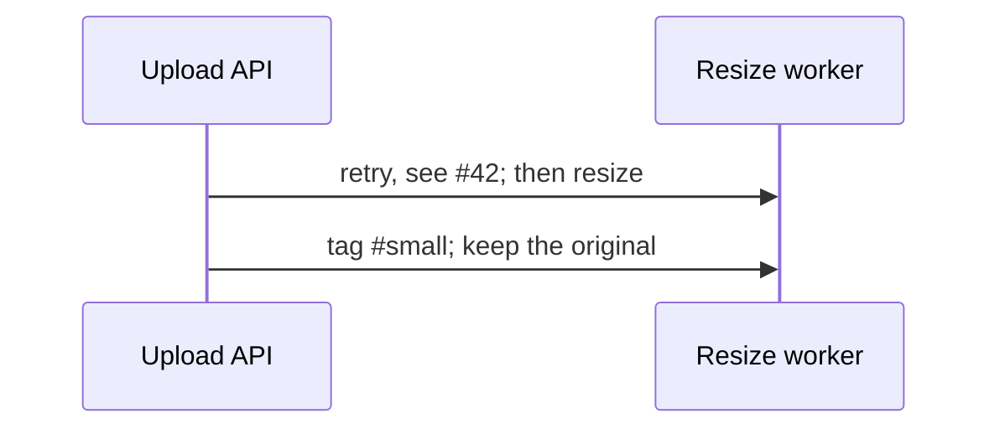

Wrong: `API->>W: retry, see #42; then resize`, which shows `see * then resize`, and `API->>W: tag #small; keep the original`, which shows `tag &small; keep the original`.

### What waits on a real render

These are limits, not rules: GitHub has not been seen rendering them, so the safe form is the one that does not depend on them.

- Prefer a short label to a line break inside it. Mermaid documents `<br/>` for sequence messages, notes and aliases, and for quoted flowchart labels, but whether it breaks the line depends on settings GitHub does not publish, and nothing documents it for state diagrams.
- Put no diagram inside a collapsed `<details>` section. GitHub fixed Mermaid inside collapsed sections for Issues, and nothing says the same for pull requests.
- Use only long-standing syntax: `flowchart` or `graph` with the classic shapes, `sequenceDiagram`, and `stateDiagram-v2`. Leave out anything Mermaid's docs mark with the version that added it, such as `@{ shape: … }`, and Markdown strings (`` "`…`" ``). Syntax newer than the version GitHub runs fails there.

## Mermaid flowcharts

### Quote every node and edge label

Unquoted label text may contain only letters, digits, spaces and some punctuation. `(`, `)`, `[`, `]`, `{`, `}` and `|` end the label or open a shape, and the diagram fails to parse. Inside double quotes, everything but `"` is plain text. Quoting costs nothing, and nobody can tell at a glance which punctuation breaks the parser, so quote every label, including an edge label between its `|` bars.

Right:

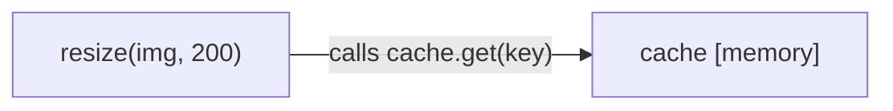

Wrong, a parse error:

```text
flowchart LR
    A[resize(img, 200)] -->|calls cache.get(key)| B[cache [memory]]
```

### Quote the whole label

Quote the label from its first character to its last, not one word in it. A quoted string can open a label, but it cannot follow plain text, so a label that starts plain and then quotes a word is a parse error.

Right:

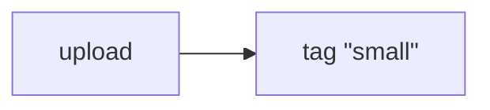

Wrong: `T[tag "small"]`.

### Write a double quote inside a label as `#quot;`

A `"` ends the quoted string. The rest of the label then shows without its quotes, or, when it contains a character such as `|`, breaks the parse. Mermaid shows `#quot;` as `"`.

Right:

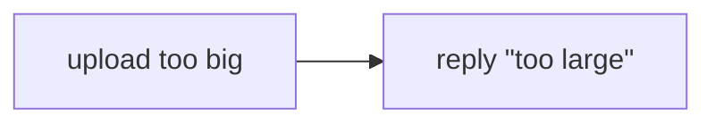

Wrong: `B["reply "too large""]`, which shows `reply too large` without its quotes, and `B["reply "a|b""]`, which does not parse.

### Write `<` and `>` in a node label as `#lt;` and `#gt;`

Mermaid draws a flowchart's node labels as HTML, so a `<` starts a tag, and the text up to the next `>` vanishes with no error. Mermaid shows `#lt;` and `#gt;` as `<` and `>`, in a node label and an edge label alike. When checked, an edge label holding `a < b` and a sequence message holding a type in angle brackets showed whole; only node labels were seen to lose text.

Right:

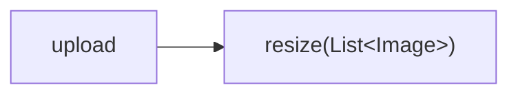

Wrong: `R["resize(List<Image>)"]`, which shows `resize(List)`.

### Give each node a short id, never `end`

Mermaid's docs warn that a node named `end` in lower case breaks a flowchart. Inside quotes, `end` is plain text, so put the words in the label and keep the id short.

Right:

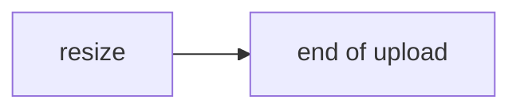

Wrong: `resize --> end`.

### Put a space on each side of every arrow

Mermaid's docs warn that a node id starting with `o` or `x` straight after an arrow joins the arrow: `---o` and `---x` draw a circle or a cross at its end.

Right:

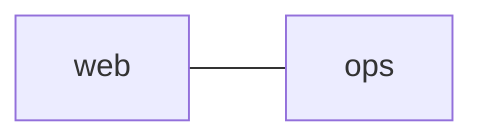

Wrong: `web---ops`, which by the docs' rule draws a circle-ended edge to a node `ps`.

## Mermaid sequence diagrams

### Give each participant a short id and an alias

Write `participant W as Resize worker`: the id stays short on every message line, and the alias carries the name as the reader should see it. Mermaid draws a participant for each new name a message uses, so a long name misspelt once draws a participant nobody meant.

Right:

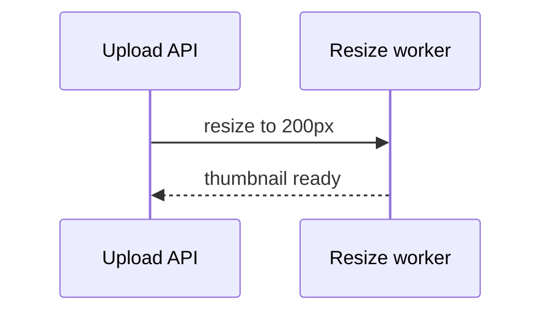

Wrong:

```text
sequenceDiagram
    Upload API->>Resize worker: resize to 200px
    Resize wroker-->>Upload API: thumbnail ready
```

The second line draws a third participant, `Resize wroker`.

### Write `#` and `;` in message text as `#35;` and `#59;`

In a sequence diagram a `;` stands for a new line, so the text after it is read as a statement of its own, which breaks the parse. A `#` starts a Mermaid comment that runs to the end of the line, so the message stops just before it: no error, only a shorter message. Mermaid shows `#35;` as `#` and `#59;` as `;`. A `;` at the very end of a line is fine, because it only ends the statement.

Right:

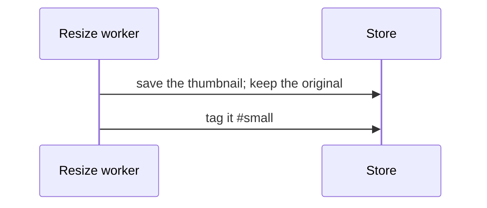

Wrong:

```text
    W->>S: save the thumbnail; keep the original
    W->>S: tag it #small
```

The first line does not parse, and the second shows only `tag it`.

### Treat every text that runs to the end of its line the same way

Not only messages end at the first `#` or `;`. So do a note's text, the label after `loop`, `alt`, `else`, `opt`, `par`, `and`, `critical`, `option` or `break`, the rest of a `box` or `rect` line, a participant's or actor's alias after `as`, and a `title`. Mermaid reads these keywords in any case, so `NOTE` and `Alt` count too. Write `#35;` and `#59;` in all of them.

Right:

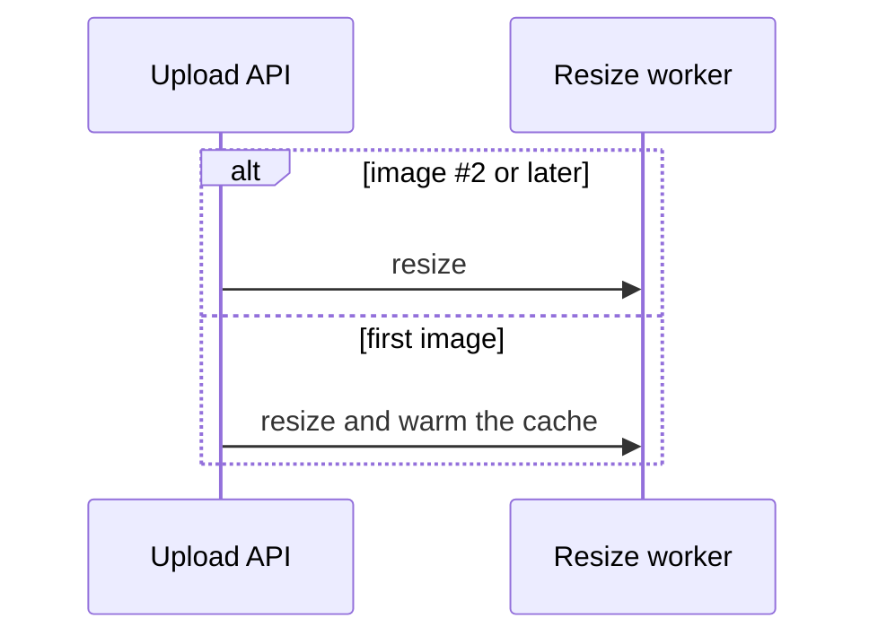

Wrong: `alt image #2 or later`, which shows only `image`.

### Leave message text unquoted

Sequence text is not quoted: quotes are part of the text, and the reader sees them. The quoting that flowcharts need does not carry over.

Right: `API->>W: resize to 200px`. Wrong: `API->>W: "resize to 200px"`, which shows the quotes.

### Keep `end` out of participant names

`end` closes a `loop`, `alt` or `opt` block, and Mermaid's docs warn that it can break the diagram as a participant's name. A short id with an alias avoids it.

Right: `participant Fin as Finish`. Wrong: `participant end`.

## Mermaid state diagrams

### Give a state with spaces or punctuation an id

Mermaid's docs give a state a name with spaces by defining it with an id first and using the id after that: `state "Waiting for upload" as Waiting`, or `Waiting: Waiting for upload`.

### Keep `;` and `:` out of transition and description labels

The label after `:` ends at a `;`, and in older Mermaid versions at a second `:` too. The rest of the line is then read as more diagram: it draws stray states, or breaks the parse.

### Use `[*]` for the start and the end

`[*]` draws the start and end markers. A state named `start` is drawn as one more ordinary box.

Right, for all three:

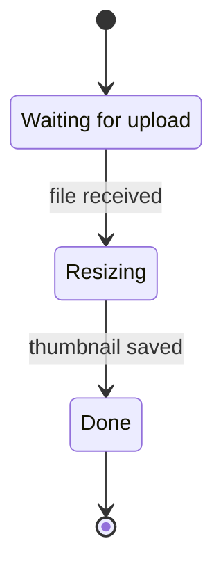

Wrong, for all three:

```text
stateDiagram-v2
    start --> Waiting for upload
    Waiting for upload --> Done: saved; size: small
```

This draws `Waiting`, `for` and `upload` as three states, a box named `start`, and stray states for `;` and `small`, and the transition's label reads only `saved`.

## Tables

A table GitHub cannot read shows as lines of raw pipes. This one is right by every rule below:

```markdown
The commands the build script now runs, and how each ended:

| Command | Result |
| --- | --- |
| `du -sh \| sort -h` | exit 0 |
| `make thumbs` | exit 2 |

The exit 2 comes from the missing `thumbs` target.
```

- **Put a blank line before and after a table.** GitHub's docs ask for the blank line before it. After it, the GFM spec ends a table only at a blank line or another block, so a plain line straight after the last row becomes one more row. Wrong: the closing sentence above on the line straight after `| make thumbs | exit 2 |`.
- **Give the header and the delimiter row the same number of cells.** Otherwise, the GFM spec says, there is no table at all. Wrong: `| Command | Result | Note |` over `| --- | --- |`.
- **Put at least three hyphens in each delimiter cell.** GitHub's docs ask for three. Wrong: `| - | - |`.
- **Escape every `|` in a cell as `\|`, inside code spans too.** The GFM spec escapes a cell's pipe this way even inside a code span, and shows it without the backslash. A bare one starts a new cell, and the rest of the row moves one column over. Wrong: `` | `du -sh | sort -h` | exit 0 | ``.
- **Keep each row on one line, with no fence or list in a cell.** The GFM spec allows no block inside a table, and a newline ends the row. Put a sample that runs over several lines in a fence under the table. Wrong: a Result cell that starts a fence of the command's output, which ends the row at the fence line.

## Fences

Every fence in this file is right by the first three rules below.

- **Close every fence.** The GFM spec runs an unclosed fence to the end of the document, so everything after it shows as code. Right: a closing line of the same character, at least as long as the opening one. Wrong: a description whose last diagram has no closing line, which turns any text after it into code.
- **Start every fence at the left margin.** The spec lets a fence start at most three spaces in. Four spaces make an indented code block, and a fence inside a bullet belongs to the bullet. Right: the opening line at column 0, below its lead-in. Wrong: a fence indented under a note's bullet.
- **Name the language in lower case: `mermaid`, `diff` or `text`, or the code's own language.** GitHub draws a diagram only for a fence marked `mermaid`, and its docs advise lower-case names. Right: an opening line of three backticks and `mermaid`. Wrong: three backticks alone, which shows the diagram's source as plain code.
- **Wrap a fence you show inside a longer one.** A block that shows a fence needs a longer outer fence, or one of tildes. Right: four backticks around a three-backtick fence, or `~~~` around it. Wrong: three around three, where the inner fence's closing line ends the outer block.

### Draw a diff sketch in a `diff` fence

GitHub colours a `diff` fence by the first character of each line: `+` as added, `-` as removed, a space as plain. So start every line with one of those three. A few other starts colour too, as something else: `---`, `+++` and `@@` as file headers and ranges, `>` and `<` followed by a space as added and removed, `!` as changed, and `#` as a comment. A `text` fence colours nothing, so `+` and `-` marks in it show as plain characters, and the reader loses the colour the sketch relies on. A blank line inside a `diff` fence is harmless.

Right:

```diff
 handle(upload)
+  if cache.has(key)
+    return cache.get(key)
   thumb = resize(upload.image, 200)
-  save(thumb)
+  save(thumb, key)
```

Wrong: the same lines in a `text` fence, or a line written `> cache first`, which colours as added.

## Line breaks

### Write each paragraph, bullet and lead-in on one line

GitHub's docs: in issues, pull requests and discussions, a newline inside a paragraph shows as a line break, while the same text in a `.md` file shows as one line. A paragraph or bullet wrapped by hand therefore breaks mid-sentence in the pull request. One line can carry several sentences; leave the wrapping to the reader's editor.

Right, on one line:

```text
- Thumbnails are now cached by key, so a second upload of the same image returns at once.
```

Wrong:

```text
- Thumbnails are now cached by key, so a second upload of the
  same image returns at once.
```

### Separate blocks with a blank line

A blank line renders the same in a `.md` file and in a pull request: put one between the why sentence, the risk line, the notes, each lead-in and each fence. The same text then works pasted into a pull request, a comment or a committed file.

Right:

```text
- Thumbnails made before this change keep their old size until the image is uploaded again.

The path an upload now takes: an image already resized returns from the cache.
```

Wrong: the same two lines with nothing between them. The GFM spec then reads the lead-in as a lazy continuation of the bullet, so the reader sees it inside the note.

## The risk line

For the risk line under the why sentence:

- **Write the emoji as characters: 🟢 🟡 🔴.** A shortcode such as `:green_circle:` is a GitHub feature, so a raw reader in a terminal sees the code, not the colour.
- **Keep the whole line on one line, with each `**…**` span closed on it, and a blank line above it.** A newline would show as a line break in the pull request.

Right:

```text
**Risk: 🟡 Medium** · **Door: two-way** · **Blast radius: image uploads**
```

Wrong: the same line broken after the first `·`, which shows as two lines.

## Mentions, issue numbers and closing words

GitHub acts on this text in a pull request description or comment, and code often contains `@` and `#`.

- **Put any `@` word in backticks.** `@name` notifies that person or team, and GitHub's docs say text in backticks is not formatted. Right: `` `@cached` now wraps `resize()` ``. Wrong: `@cached now wraps resize()`, which notifies whoever owns the name `cached`.
- **Write `#` and a number only for a real reference.** `#12`, `GH-12`, `owner/repo#12` and a full commit hash become links. Right: "the third retry". Wrong: "retry #3", which links issue or pull request 3.
- **Put a closing word before an issue reference only when the branch closes it.** In a pull request description, `close`, `closes`, `closed`, `fix`, `fixes`, `fixed`, `resolve`, `resolves` and `resolved`, in any case and with or without a colon, close the issue they precede when the pull request merges into the default branch. Write one only when the branch's own commit messages already link that issue. Right: "Stretched thumbnails, reported in #12, now keep their shape". Wrong: "This fixes #12" when nothing in the branch says so.

## Length

Keep the description under 65,536 characters, counting each emoji as one. GitHub's docs give no limit, but its error message for a longer body or comment names that figure. A description that follows the main instructions is far shorter. Right: a description of a few thousand characters, with any long output left in the files it came from. Wrong: a whole log or generated file pasted in, which can pass the limit, and GitHub then refuses to save the description.
