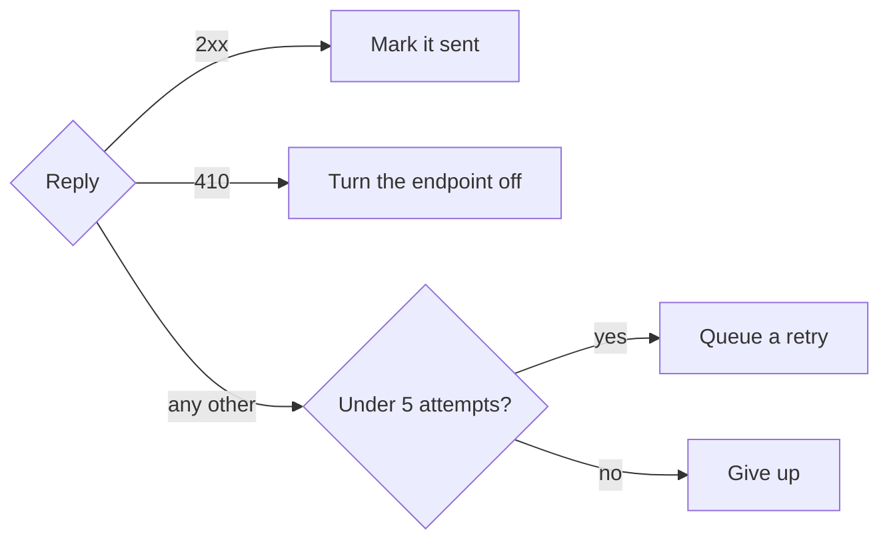
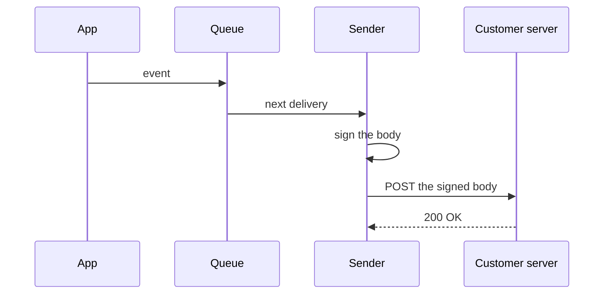
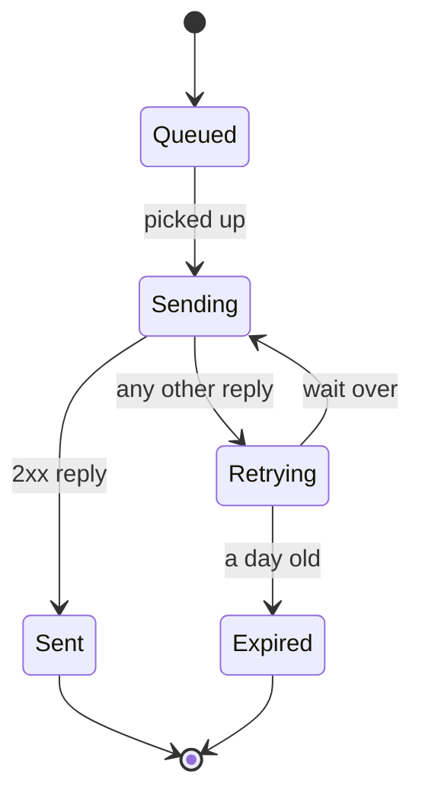

# Views for the change outline

Each view draws one kind of structure. You may use one or several, and you will rarely use them all: the main instructions say which view fits which kind of change, and this file shows each one.

| View | Fence | Draws |
| --- | --- | --- |
| Diff sketch | `diff` | What changes in a shape that already exists: lines in their function, a file tree, a call tree, or pseudocode. |
| File tree | `text` | Where responsibilities live, or where new files sit. |
| Pseudocode | `text` | Logic or an algorithm, in the order it runs. |
| Call tree | `text` | Runtime control flow: what calls what. |
| Mermaid flowchart | `mermaid` | A path through the code that branches. |
| Mermaid sequence diagram | `mermaid` | The messages between parts, in the order they are sent. |
| Mermaid state diagram | `mermaid` | The states something passes through, and what moves it between them. |
| Whole block | the code's language | A shape that is mostly new, or one where cutting context would hide who owns what or what runs in which order. |
| Outcome table | none: a Markdown table | Inputs against their results, beside a fenced view and never in its place. |

Every example below is invented: a different change to a service that sends webhooks, the HTTP calls that tell a customer's server that an event happened. The line just above each block or table is its lead-in, written as a description would carry it: it opens with what the whole visual draws, then says what to notice. A lead-in that names one part of a visual that draws several leaves the reader to find the rest alone.

## Diff sketch

Use a diff sketch when the point is what changes and the surrounding shape already exists. Match its shape to the topic: the changed lines inside their function for a small change, a file tree for moved files, a call tree for a new call, pseudocode for changed logic. Mark added lines with `+` and removed lines with `-`, and start every other line with a space, as a real diff does, so a reader who knows the notation reads it at a glance. The rendering-on-GitHub reference that the main instructions link says which other line starts a `diff` fence colours, and why the marks show no colour in a `text` fence.

`retry_after()`, which sets the wait before each retry, old and new: the wait now doubles with each attempt, so the fifth retry waits 32 seconds where it waited 10 (read from the code, not run).

```diff
 def retry_after(attempt):
-    return 2 * attempt
+    return 2 ** attempt
```

The service's files that send webhooks, before and after: both move into a new `webhooks/` folder and drop their `hook_` prefix, and nothing inside them changes.

```diff
 service/
-  hook_sender.py
-  hook_signing.py
   models.py
+  webhooks/
+    sender.py
+    signing.py
```

## Diff sketch or whole block

Show the whole block instead when most of it is new, or when diff notation would hide ownership or order. A reader then sees the shape they will find in the code. A change of a few lines to code that already exists is a diff sketch: a whole block would show only the new lines, and leave the reader to guess the old ones.

## File tree

A file tree places files: where a responsibility lives, or where new files sit that the reader will look for. Keep only the entries the point needs. A tree that only lists the files the diff already lists, or says what each one does, is a catalogue, not a view. For files that moved, draw the tree as a diff sketch, as above, so the reader sees each file's old and new place.

Where the new signing module sits in the service: inside `webhooks/`, beside the sender that calls it, not with the shared helpers in `util/`.

```text
service/
├── util/
└── webhooks/
    ├── sender.py
    └── signing.py    new
```

## Pseudocode

Pseudocode gives logic in the order it runs, in the code's own names, with what does not bear on the point left out.

The loop that sends each queued delivery, step by step: a reply of 410 Gone now turns the endpoint off, where it used to be retried like any other failure.

```text
for each queued delivery
  post the signed body to the endpoint
  if the reply is 2xx: mark the delivery sent
  if the reply is 410: turn the endpoint off and drop its queue
  otherwise, under 5 attempts: queue a retry after retry_after(attempts)
  otherwise: give up on the delivery
```

## Call tree

A call tree shows what calls what when the code runs, so a new step or a call that moved shows as a branch that is new or in a new place.

What `flush_queue()` calls for each delivery: `sign()` is a new call, between building the body and posting it.

```text
flush_queue()
└── deliver(delivery)
    ├── build_body(delivery.event)
    ├── sign(body, endpoint.secret)    new
    └── post(endpoint.url, body)
```

## Mermaid flowchart

A flowchart fits a path that branches: the reader follows one input through it and sees which way it goes at each decision.

Where a delivery goes after each reply: a 410 is now a branch of its own, which ends with the endpoint turned off rather than another retry.



This flowchart and the pseudocode above draw the same change. A description draws it once, in whichever of the two makes the point faster: here the flowchart, because the change is a new branch.

## Mermaid sequence diagram

A sequence diagram fits an interaction: which part sends what to which, in order. Use it when a change moves a step from one part to another, or adds a message.

The messages for one event, from the app through the queue and the sender to the customer's server: signing now happens in the sender, so the app never handles a customer's secret.



## Mermaid state diagram

A state diagram fits something that passes through states: each box is a state, and each arrow is labelled with what moves it on. Use it when a change adds a state or a transition, or changes what triggers one.

The states a delivery passes through, and what moves it from each to the next: `Expired` is new, so a delivery still failing a day after its event stops there instead of retrying without end.



## Whole block

A whole block is the code itself, for a part that is mostly new or whose order matters more than what changed.

`disable_endpoint()`, which is all new, in full: it empties the endpoint's queue before it emails the owner, so no webhook goes out after the email says they have stopped.

```python
def disable_endpoint(endpoint, reason):
    endpoint.enabled = False
    queue.cancel(endpoint_id=endpoint.id)
    email_owner(endpoint, f"Webhooks to {endpoint.url} have stopped: {reason}")
```

## Outcome table

An outcome table sets inputs against their results. It samples a few inputs, where a fenced view draws the rule that produces them, so it goes beside a fenced view, such as the flowchart above, and never in its place. It is a Markdown table, not a fenced block, so it renders as a table.

What the sender does with each kind of reply, before and after: only a 410 is handled differently (read from the code, not run).

| Reply | Before | After |
| --- | --- | --- |
| 2xx | marked sent | marked sent |
| 410 | retried, up to 5 attempts | endpoint turned off |
| 500 | retried, up to 5 attempts | retried, up to 5 attempts |

## Keep each view small

Keep only the calls, files, states and boundaries the point needs. Name things as the code names them, so a reader can find them, and leave out what does not bear on the point. A sketch that tries to show everything shows nothing in particular.

## When a second view earns its place

A second view earns its place by drawing a structure the first leaves out. These do:

- The diff sketch behind a flow, when the flow hides which lines changed.
- A view of a second change that the why or a note rests on.

These do not, so cut them:

- A view that retells another, such as the pseudocode and the flowchart above side by side.
- A file tree after a diff sketch that already names the same files.
- A sample of use, such as a command and what it prints, that shows what the why already says. Output the request asked for is the exception: it stays.
- A closing catalogue: a last block that lists every changed file, or retells the whole change. The diff already lists the files, and a last block written to sum up gets the least care, so its errors are the easiest to miss. A file tree that draws a move, or places new files the diff does not show, is a view, not a catalogue.
